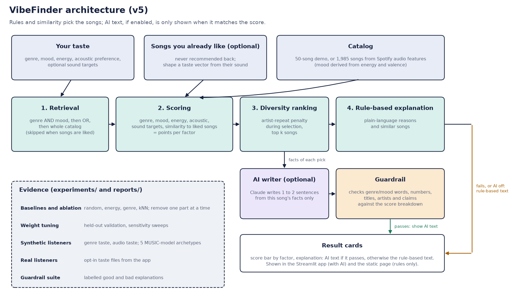
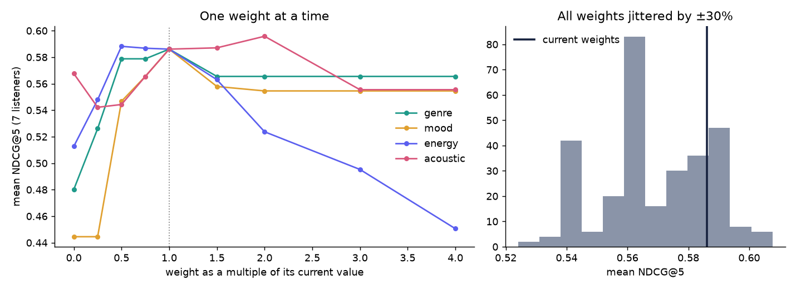

# Music Recommender: Retrieval + Ranking with Explanations

## Original Project
**Music Recommender Simulation** was a simple content-based recommender that suggests songs from user preferences for genre, mood and song features. The goal was to see how recommenders turn data into predictions, where bias creeps in, and how scoring choices change results.

## Summary
This version turns that starter into a small, testable recommender with retrieval, scoring, diversity-aware ranking, and explanations. It filters a song catalog, scores candidates, selects a diverse list, and writes a plain-language explanation for every recommendation. It is rule-based on purpose, so every score can be traced and explained. It does not use machine learning or an LLM.

## Architecture


1. **Retrieval** (`retrieve_candidates`): narrows the catalog by genre/mood. The filter relaxes step by step (genre AND mood, then genre OR mood, then the whole catalog) until at least `k` candidates are available or the catalog is exhausted.
2. **Scoring** (`score_song`): one function used everywhere. Genre and mood matches, a smooth energy-closeness curve, and acousticness all count. Optional user targets such as valence, danceability, tempo, decade, detailed mood, instrumental preference, and language are used when supplied and supported by the data. Popularity is scored automatically when a song has that field. All weights live in `WEIGHTS`.
3. **Diversity-aware ranking** (`rank_with_diversity`): greedy selection that subtracts a penalty each time an artist repeats, so a slightly lower-scoring song by a new artist can win a slot.
4. **Explanation** (`explain_song`): lists why each song matched and suggests two similar songs (shared genre/mood/artist).

`Recommender` (the OO class) is a thin wrapper over the same functions, so class tests and the CLI exercise identical logic.

## Getting Started
Requires Python and pip. On Windows PowerShell:
```bash
python -m venv .venv
.\.venv\Scripts\Activate.ps1
pip install -r requirements.txt
```

On macOS/Linux, activate the environment with `source .venv/bin/activate` instead. Then run any of the following from the project root:

```bash
streamlit run app.py      # interactive app using the Python recommender
python -m src.main        # command-line demo with four user profiles
python evaluation.py      # metrics and guardrail checks (exit code 1 on failure)
python -m pytest          # automated test suite
python -m experiments.run_v1  # compare baselines and run the v1 ablation study
python -m experiments.run_v2  # tune weights and measure sensitivity
```

## Streamlit App (`app.py`)
The main frontend. It imports `src.recommender` directly (via `recommend_detailed`), so it shows exactly what the real system does, with no copy of the logic. Pick a genre, mood and energy (or click an example taste) and each recommendation shows the score breakdown by part, the retrieval funnel (catalog, candidates, picks), any repeat-artist penalty, and the written explanation. To deploy for free, push the repo to GitHub and create an app at share.streamlit.io pointing at `app.py`.

## Static Web Demo (optional)
A no-install, single-file copy lives in `docs/index.html`: pick a genre, mood and energy (or an example taste), and each recommendation shows a colour-coded score breakdown, the retrieval funnel (catalog, candidates, picks) and the written explanation.
```bash
python scripts/build_web.py            # rebuild docs/index.html from web/ + data/songs.csv
python scripts/check_web_parity.py     # confirm the JS engine ranks exactly like the Python one
python -m http.server -d docs 8000     # then open http://localhost:8000
```
The parity check requires Node.js in addition to the Python dependencies.
To host it free, go to GitHub, then Settings, then Pages, choose branch `main` and folder `/docs`.
Unlike the Streamlit app, this page uses `web/engine.js`, a JavaScript port of `src/recommender.py`, so the page runs entirely in the browser with no server. If you change weights or ranking in Python, mirror the change in `web/engine.js` and re-run the parity check.

## Data
- `data/songs.csv`: 50 songs, 48 artists, 27 genres, with 10 columns (id, title, artist, genre, mood, energy, tempo_bpm, valence, danceability, acousticness). This is the catalog the app and evaluation use.
- `data/songs_new.csv`: 20-song sample that also has `popularity`, `release_decade`, `detailed_mood`, `instrumentalness` and `language`. These optional columns are supported by the scorer but are not in the main catalog.
- `data/eval_listeners.json`: hand-labelled listener seed songs and held-out liked songs for offline evaluation.

## Sample Interaction
**Input:** `{"genre": "pop", "mood": "happy", "energy": 0.8}`
```
User profile: {'genre': 'pop', 'mood': 'happy', 'energy': 0.8}

Top recommendations:
- Sunrise City by Neon Echo
  Score: 4.56
  Reasons: This song matches your favorite genre 'pop', matches your favorite mood 'happy',
  has energy level very close to your target, is not very acoustic, matching your preference.
  Similar songs you might like: 'Gym Hero' by Max Pulse, 'Night Drive Loop' by Neon Echo.
----------------------------------------
```

## Evaluation (`python evaluation.py`, k=5, 7 profiles, 50-song catalog)
| Metric | Result |
|---|---|
| Mean genre match | 0.40 |
| Mean mood match | 0.43 |
| Mean artist diversity | 1.00 |
| Catalog coverage | 0.52 (26 of 50 songs recommended) |
| Guardrails (k results, no duplicates, explanations present) | all passed |

Genre match is low for rock, electronic and blues because the catalog has only one to two songs per genre. The system broadens retrieval and ranks the available candidates rather than failing. See `model_card.md`.

## Baselines and Ablation (v1)
Run `python -m experiments.run_v1` to compare the recommender with simple baselines and measure how individual system components affect results. Each listener's taste profile is derived from three seed songs; those seeds are removed from the candidate catalog, and recommendations are evaluated against that listener's held-out liked songs. Results are saved in `reports/v1_results.md`.

| Method | Precision@5 | NDCG@5 | NDCG@5 95% interval |
|---|---:|---:|---|
| Random (average of 500 draws) | 0.10 | 0.11 | 0.10 to 0.13 |
| Energy only | 0.31 | 0.31 | 0.10 to 0.54 |
| Genre only | 0.40 | 0.45 | 0.20 to 0.67 |
| Genre + mood rules, no scoring | 0.26 | 0.36 | 0.17 to 0.55 |
| Audio-feature nearest neighbours | 0.26 | 0.30 | 0.14 to 0.47 |
| **This system** | **0.46** | **0.59** | **0.41 to 0.77** |

The full system has the best average NDCG and a hit rate of 1.00 in this evaluation, but only seven listeners were labelled and the confidence intervals overlap. Treat this as an encouraging signal, not proof of general performance. The ablation suggests mood, genre, and energy contribute most to relevance; the diversity penalty and retrieval filter primarily improve variety and efficiency here.

## Weight Tuning and Sensitivity (v2)
Run `python -m experiments.run_v2` to compare the current weights with a deterministic random search over 800 configurations, evaluate tuning with leave-one-listener-out validation, and measure sensitivity to individual and joint weight changes. Outputs are saved to `reports/v2_results.md` and `reports/v2_sensitivity.png`.

The best configuration scored 0.62 NDCG@5 on all seven listeners, compared with 0.59 for the current weights. However, tuning on six listeners and evaluating on the held-out listener scored 0.56 versus 0.59 for the current weights. This suggests the apparent in-sample gain overfits the small evaluation set, so the project keeps its existing weights. The results are indicative, not conclusive, with only seven hand-labelled listeners. Sensitivity analysis shows mood and energy weights have the greatest effect; the full ranges and methodology are in the [v2 report](reports/v2_results.md) and [model card](model_card.md).



## Reliability & Testing
`tests/` includes parametrized reliability checks across six profiles and four values of `k`, as well as checks for:
- exactly `k` unique, score-sorted, explained results, including rare combinations and total mismatches;
- edge cases: `k=0`, empty catalog, `k` larger than the catalog, out-of-range energy;
- ranking quality: exact matches rank first, genre matches dominate when available;
- the energy score has no cliffs, and optional targets change ranking;
- the diversity penalty really swaps in a new artist;
- the class wrapper and functional pipeline agree;
- both CSVs load with valid value ranges;
- detailed score breakdowns agree with the final scores;
- baseline implementations and evaluation metrics behave correctly;
- the v1 experiment and report cover baseline comparisons and ablations;
- weight sampling is reproducible, ties prefer configurations near the defaults, and leave-one-listener-out validation excludes the held-out listener.

## Design Decisions and Trade-offs
- **Interpretability over accuracy:** simple weights and rule-based explanations, at the cost of no collaborative filtering or learned taste.
- **Progressive retrieval relaxation:** the system returns up to `k` results, broadening the candidate pool for rare tastes. If the catalog contains fewer than `k` songs, it returns all available songs; an empty catalog returns no results.
- **One scoring path:** removes drift between the tested class and the shipped function.
- **Logging:** the library uses `logging.getLogger(__name__)` and leaves handler setup to the application.

## Limitations and Responsible Use
- Tiny, uneven catalog: niche or conflicting tastes get weak matches, and common genres (pop, lofi) dominate.
- Content-based scoring reinforces existing taste and can create filter bubbles. The diversity penalty only spreads artists, not genres.
- Explanations are rule-based and describe the scoring, not the user's intent.
- Intended for learning only, not for production streaming or high-stakes decisions.

## Collaboration with AI
AI helped structure the pipeline into retrieval, scoring, explanation and evaluation. One flawed suggestion was to create a new README instead of editing the existing one, which would have caused conflicts, a reminder to review AI-generated changes before applying them. A later AI code review found real bugs (an over-permissive retrieval filter, a diversity penalty applied after the top-k cut, duplicated scoring logic, and docs that didn't match the data), which are fixed in this version.
